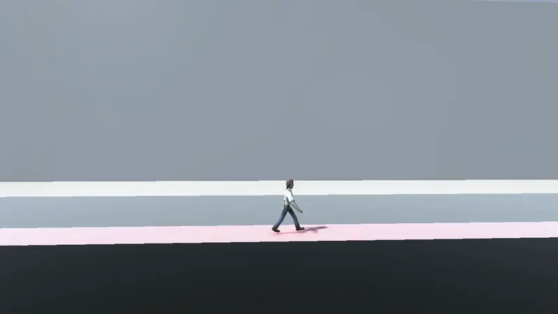
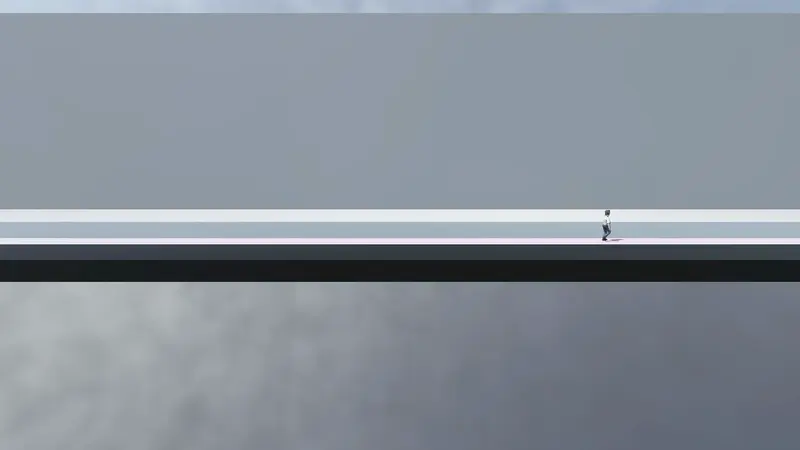

# DeadLine · Cámara lateral

En la pista de *Andy’s Playground*, la cámara observa al personaje desde el mismo lado con tres modos de encuadre. [Descargar la demo para Windows](https://github.com/shaw207/deadline-camera/releases/tag/v1.0.0)

<strong>Seguimiento y plano fijo</strong>

Al arrancar y frenar, la cámara alcanza al personaje con un pequeño retardo. En la siguiente zona, el personaje cruza el plano mientras la cámara permanece fija.

<strong>Raíl y cambio de sentido</strong>

El personaje avanza por el raíl durante nueve segundos, frena y da media vuelta. El suavizado de 3 s hace que la cámara termine de avanzar antes de seguirlo en sentido contrario.

## Probar

Extrae el ZIP y abre `DeadLine-Camera-Spline3.exe`. Avanza con **W**, retrocede con **S** y mantén **Mayús** para correr. **R** reinicia el recorrido y **Esc** cierra el juego.

En Unity **6000.3.25f1**, abre [CameraPlayground](Assets/CameraPlayground/CameraPlayground.unity) y pulsa **Play**.

Sistema de cámara de Chengxun Wu. El personaje, las animaciones y los materiales se usan con permiso del equipo de *DeadLine*. [Código de la cámara](Assets/DeadLine/Scripts/Camera) · [Licencias](licenses)
